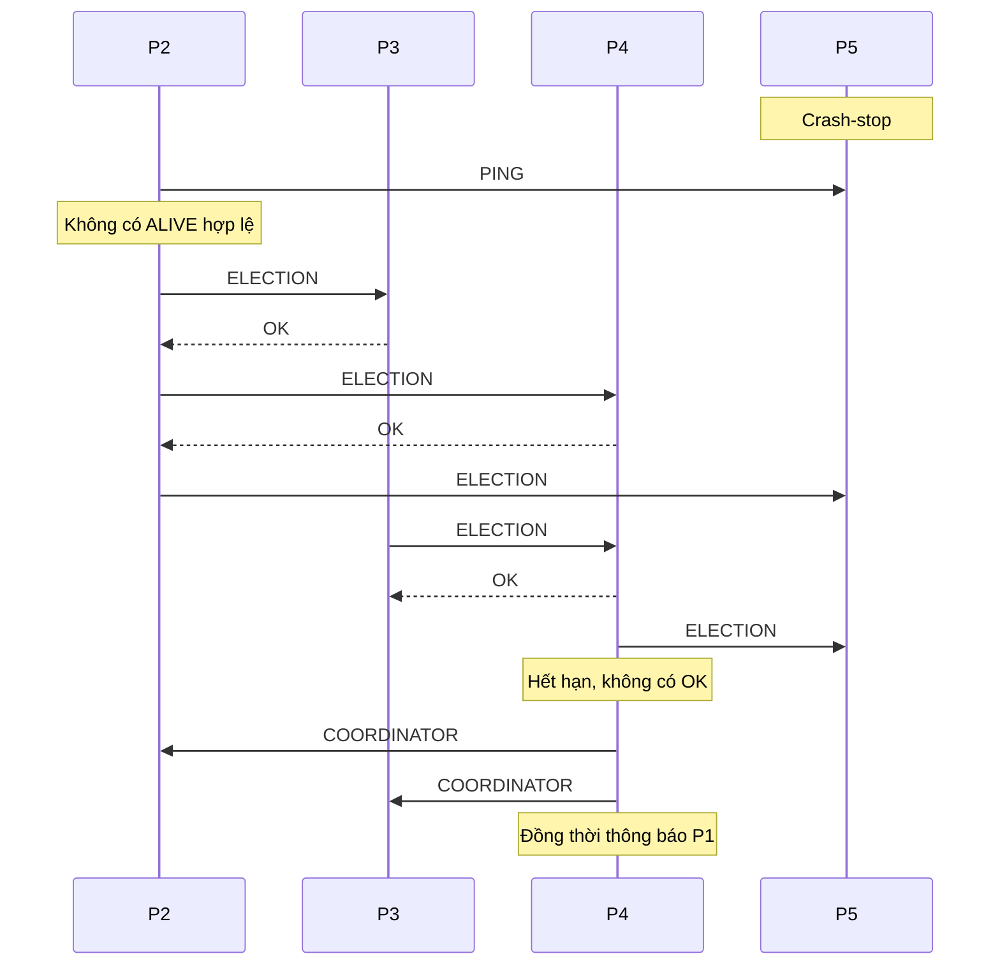

# Lab 04 - Distributed Leader Election bằng Go

Project mô phỏng **5 tiến trình P1, P2, P3, P4, P5** giao tiếp qua **TCP socket**,
bầu leader bằng **thuật toán Bully**. P5 là leader ban đầu. Chương trình tự dừng
P5; các node còn sống tự phát hiện lỗi, bầu P4 và kiểm tra kết quả.

Tài liệu này giải thích cả ý tưởng lẫn cách đọc code. Bạn nên chạy chương trình
một lần, đọc phần 3-6 để hiểu thuật toán, rồi mở code theo phần 7.

## 1. Chạy project

### Yêu cầu

- Go 1.22 trở lên; kiểm tra bằng `go version`.
- Không cần tải thư viện ngoài, database hay chạy server riêng.
- Hệ điều hành cho phép mở TCP trên localhost.

Từ thư mục gốc repository:

```powershell
cd Lap_04
go run .
```

Chương trình tự kết thúc sau khi xác minh leader mới ổn định. Console đồng thời
được lưu trong `trace.log`. Nếu lỗi, chương trình in lỗi và trả exit code 1.

Có thể điều chỉnh thời gian dừng P5 và tên file log:

```powershell
go run . -crash-after=2s -log=my-trace.log
```

Tham số `-crash-after=2s` nghĩa là chạy bình thường 2 giây rồi dừng P5.
Không truyền tham số thì mặc định là 1 giây. Thời gian âm bị từ chối.
Mỗi lần chạy sẽ ghi đè file log đã chọn.

Biên dịch và chạy trên Windows:

```powershell
go build -o leader-election.exe .
.\leader-election.exe
```

Trên Linux/macOS:

```bash
go build -o leader-election .
./leader-election
```

Lưu ý: dùng `go run .` để chạy tất cả file Go của package. `go run main.go`
chỉ nạp một file và sẽ báo thiếu các hàm nằm ở file khác.

## 2. Cấu trúc project

```text
Lap_04/
  go.mod                 Tên module và phiên bản Go tối thiểu
  main.go                Tham số, console/file log, xử lý Ctrl+C
  simulation.go          Tạo 5 node, dừng P5, xác minh và dọn dẹp
  protocol.go            Loại bản tin, trạng thái, các khoảng chờ
  node.go                Toàn bộ logic heartbeat và Bully
  transport.go           Gửi/nhận JSON qua TCP
  node_test.go           Kiểm thử thuật toán và socket
  README.md              Hướng dẫn chi tiết này
  trace.log              Console trace từ lần chạy thực tế
  report.py              Mã tạo lại báo cáo PDF
  output/pdf/
    architecture-report.pdf  Báo cáo kiến trúc đúng 2 trang
```

File thực thi và thư mục ảnh tạm được bỏ qua bởi `.gitignore`.
Mã nguồn, README, trace và PDF vẫn có thể được đưa vào Git.

## 3. Leader là gì? Tại sao P4 thắng?

Leader, còn gọi là coordinator, là node được các node khác công nhận để đảm
nhiệm vai trò điều phối. Lab chỉ mô phỏng việc chọn leader; không triển khai
nghiệp vụ như phân việc, ghi dữ liệu hay sao chép dữ liệu.

Bully dùng **ID của node làm mức ưu tiên**:

```text
P1 < P2 < P3 < P4 < P5
```

ID lớn hơn có quyền thắng node ID nhỏ hơn. Vì vậy:

- Khi cả 5 node sống, leader ban đầu là P5.
- Khi P5 dừng, ID lớn nhất còn sống là 4, nên P4 phải thắng.
- Không phải node phát hiện lỗi trước sẽ thắng; nó chỉ khởi động bầu cử.

Ban đầu, tất cả node được cấu hình đã biết leader P5 theo kịch bản đề bài.
Project không chạy một vòng bầu cử khởi tạo trước khi gây lỗi.

## 4. Các node giao tiếp như thế nào?

Mỗi node có một socket lắng nghe riêng, ví dụ:

```text
P1 -> 127.0.0.1:53001
P2 -> 127.0.0.1:53002
...
P5 -> 127.0.0.1:53005
```

Đây chỉ là ví dụ. Code dùng `net.Listen("tcp", "127.0.0.1:0")`: cổng 0 yêu cầu
hệ điều hành cấp cổng trống. Địa chỉ thật được in đầu log. Cách này tránh xung
đột cổng và cho phép chạy nhiều bản demo.

Mọi node giữ danh sách địa chỉ các node khác, gọi là `peers`. Danh sách này
không cho biết node nào đang sống; muốn biết phải thử trao đổi qua TCP.

### Các bản tin

| Loại | Ý nghĩa | Phản hồi |
|---|---|---|
| PING | Follower hỏi leader còn hoạt động không | ALIVE nếu đích đang là leader |
| ELECTION | Node hỏi node có ID cao hơn tham gia bầu cử | OK |
| COORDINATOR | Người thắng công bố mình là leader | OK xác nhận đã nhận |
| REJECT | Không chấp nhận request hoặc ID người gửi | Kết thúc request |

Ví dụ P2 gửi ELECTION cho P4:

```json
{"type":"ELECTION","from":2}
```

P4 phản hồi trên chính kết nối đó:

```json
{"type":"OK","from":4}
```

`call()` trong `transport.go` mở một kết nối TCP, đặt deadline, gửi một JSON,
đọc một JSON phản hồi rồi đóng kết nối. Mỗi request dùng một kết nối riêng,
giúp giao thức ngắn và dễ đọc.

**OK có hai ngữ cảnh:** trả lời ELECTION nghĩa là “tôi có ID cao hơn và sẽ tham
gia”; trả lời COORDINATOR chỉ xác nhận đã nhận thông báo. `rpcResult.kind`
giữ loại request gốc để code phân biệt hai trường hợp.

Các channel `inbox` và `results` chỉ kết nối goroutine **trong cùng một node**.
Không có bản tin bầu cử nào được gửi trực tiếp qua channel từ node này sang node khác.

## 5. Tự động phát hiện P5 dừng

Follower gửi PING tới leader định kỳ. Leader trả ALIVE khi nó đang giữ vai trò
leader. Không in heartbeat thành công để trace bầu cử dễ đọc.

Các khoảng thời gian nằm trong `defaultTiming()` ở `protocol.go`:

| Giá trị | Mặc định | Mục đích |
|---|---|---|
| RPC | 200 ms | Hạn kết nối/trao đổi một request TCP |
| Heartbeat | 300 ms | Chu kỳ hỏi leader |
| Election | 600 ms | Cửa sổ chờ OK từ các ID cao hơn |
| Coordinator | 1.500 ms | Chờ người có ID cao hơn công bố chiến thắng |
| Tick | 20 ms | Nhịp vòng lặp kiểm tra các mốc thời gian |

Trong `onTick()`, node ở trạng thái IDLE sẽ gửi PING nếu đã đến hạn.
`pingPending` bảo đảm không chồng nhiều PING đang chờ trên cùng một node.

Khi PING thất bại, `onResult()` in:

```text
[P2] Timeout detected! Leader P5 unreachable.
```

Sau đó node **tự gọi `startElection()`**. Lỗi kết nối, hết deadline, phản hồi
sai loại hoặc sai ID đều được xem là không xác nhận được leader.

P5 đã đóng socket có thể gây `connection refused` ngay, không cần đợi đủ
200 ms. Dòng “Timeout detected” được dùng chung cho các trường hợp leader
không phản hồi hợp lệ, để phù hợp trace của bài lab.

## 6. Bully từng bước

Giả sử P2 phát hiện lỗi trước:

### Bước 1: P2 hỏi các node có ID cao hơn

`startElection()` chuyển P2 sang WAIT_OK, đặt leader = 0, tăng số vòng
`round`, đặt thời hạn rồi gửi:

```text
P2 -> P3: ELECTION
P2 -> P4: ELECTION
P2 -> P5: ELECTION
```

P2 không hỏi P1 vì P1 có ưu tiên thấp hơn, không thể ngăn P2 thắng.

### Bước 2: Node cao hơn trả OK và tự bầu

P3 và P4 còn sống nên trả OK cho P2. Mỗi node đó cũng gọi `startElection()`:

```text
P3 -> P4, P5: ELECTION
P4 -> P5: ELECTION
```

Nếu node đã ở WAIT_OK hoặc WAIT_COORDINATOR thì không mở thêm vòng bầu cử
song song cho chính nó. Nó vẫn trả OK cho node thấp hơn.

P5 đã dừng nên không trả lời.

### Bước 3: Có OK thì chờ coordinator

P2 biết có node ưu tiên cao hơn còn sống nên không được tự tuyên bố thắng.
Khi cửa sổ Election hết, P2 chuyển sang WAIT_COORDINATOR.

Tại sao cần hạn Coordinator? Một node có thể đã trả OK rồi bị lỗi trước khi
công bố chiến thắng. Nếu chờ vô hạn, P2 sẽ bị kẹt. Khi hết hạn Coordinator,
P2 mở vòng bầu cử mới.

### Bước 4: P4 không nhận OK nên thắng

P4 chỉ hỏi P5. Hết cửa sổ Election mà không có OK, `becomeLeader()`:

1. Gán leader của P4 bằng 4.
2. Đưa P4 về IDLE.
3. In NEW LEADER.
4. Gửi COORDINATOR tới P1, P2, P3.

### Bước 5: Follower nhận leader mới

Trong `onMessage()`, P1-P3 nhận COORDINATOR từ P4, chấp nhận vì 4 lớn hơn ID
của chúng, cập nhật leader = 4 và quay về IDLE.

Từ đây heartbeat sẽ gửi tới P4. Main chỉ đọc để kiểm tra, **không gán leader
cho P1-P3**.



Đây là một lịch chạy minh họa. Thực tế P1, P3 hoặc P4 có thể phát hiện lỗi
trước P2. Nhiều node khởi động bầu cử đồng thời là hành vi hợp lệ của Bully.

## 7. Cách đọc từng file code

### main.go - Điểm bắt đầu

`main()` đọc tham số, mở file log, tạo context có thể hủy bằng Ctrl+C và gọi
`simulate()`. `io.MultiWriter` ghi cùng trace ra console và file.
Cuối cùng đóng file, báo lỗi nếu có.

### simulation.go - Người dựng kịch bản

`createCluster()` mở đủ 5 listener, tạo đầy đủ địa chỉ peer rồi mới chạy node.
Việc tạo trước tránh một node gửi đến node khác khi listener chưa sẵn sàng.

`simulate()` thực hiện:

1. Tạo cluster với leader ban đầu P5.
2. Chờ khoảng `crashAfter`.
3. Gọi `Stop()` chỉ trên P5.
4. Đợi P1-P4 cùng công nhận P4 và giữ ổn định trong 600 ms.
5. In VERIFY/PASS và dừng toàn bộ node.

Việc kiểm tra có hạn 10 giây. Nếu trong lúc theo dõi có node không còn công
nhận P4, thời gian ổn định được tính lại. Nó không chỉ chụp một lần rồi kết
luận thành công.

`traceLogger` khóa việc ghi từng dòng bằng mutex. Lỗi ghi console/file được
giữ lại để `simulate()` trả lỗi, thay vì âm thầm coi log đã lưu thành công.

### protocol.go - Từ vựng và dữ liệu

File định nghĩa các loại Message, ba trạng thái và Timing.

`request` là request TCP đã decode kèm channel để trả lời.
`rpcResult` là kết quả gửi TCP, gồm loại request, node đích, vòng bầu cử và
cờ thành công.

### node.go - Trái tim thuật toán

| Hàm | Nhiệm vụ |
|---|---|
| newNode() | Chuẩn bị dữ liệu, bản sao peer map, channel và leader ban đầu |
| Start() | Khởi động listener loop và vòng lặp trạng thái |
| Stop() | Đóng node và chờ worker kết thúc |
| run() | Nhận request, nhận kết quả I/O hoặc xử lý nhịp thời gian |
| startElection() | Bắt đầu vòng bầu, gửi tới các ID cao hơn |
| onMessage() | Xử lý PING, ELECTION, COORDINATOR đến |
| onResult() | Xử lý phản hồi/kết nối lỗi của bản tin đã gửi |
| onTick() | Kiểm tra hạn heartbeat, chờ OK và chờ coordinator |
| becomeLeader() | Tự nhận leader và thông báo các ID thấp hơn |
| Leader() | Đọc leader an toàn từ bên ngoài vòng lặp |

Bạn nên đọc `run -> onTick -> onResult -> startElection -> onMessage ->
becomeLeader` để lần theo kịch bản chính.

### transport.go - Giao tiếp mạng

`acceptConnections()` nhận kết nối, mỗi kết nối có worker xử lý riêng.
`handleConnection()` đọc JSON, gửi request vào inbox của node và ghi phản hồi.

`send()` tạo worker gọi TCP; worker đưa `rpcResult` về channel results.
Nó không tự sửa leader hoặc trạng thái bầu cử.

## 8. Trạng thái, goroutine và an toàn dữ liệu

### Ba trạng thái

| Trạng thái | Đang làm gì? | Điều kiện chuyển |
|---|---|---|
| IDLE | Biết leader hoặc đang làm leader | Heartbeat lỗi/nhận ELECTION thì bắt đầu bầu |
| WAIT_OK | Đã gửi ELECTION, đợi phản hồi từ ID cao hơn | Hết hạn: không OK thì thắng; có OK thì chờ coordinator |
| WAIT_COORDINATOR | Có node ưu tiên cao hơn, chờ nó công bố | Nhận COORDINATOR thì IDLE; hết hạn thì bầu lại |

COORDINATOR hợp lệ từ node cao hơn có thể đưa node về IDLE từ cả hai trạng
thái chờ.

### Vì sao chỉ run() sửa trạng thái?

Giả sử hai worker cùng sửa `higherOK`, `state` hoặc `round`: code dễ có
data race, kết quả tùy thời điểm chạy. Project giao toàn bộ các biến đó cho
**một goroutine run()**. Các worker chỉ gửi dữ liệu vào channel.

```text
TCP request -> handleConnection -> inbox   -> run -> onMessage
TCP reply   -> send worker      -> results -> run -> onResult
Ticker                                     -> run -> onTick
```

Riêng `publishedLeader` dùng atomic vì main cần đọc nó khi run() đang ghi.
Atomic này dùng cho quan sát, không dùng để các node trao đổi leader với nhau.

### Vì sao gửi TCP phải bất đồng bộ?

Nếu P2 giữ vòng lặp chờ P3 trả lời, trong khi P3 đang chờ P2 xử lý một request
khác, các node có thể chờ nhau. Với worker TCP riêng, run() vẫn nhận request
và xử lý timeout khi một cuộc gọi mạng đang chờ.

### round giải quyết phản hồi muộn như thế nào?

Ví dụ một PING của vòng 3 đang bay trên mạng. Node đã nhận COORDINATOR và
chuyển sang vòng 4, nhưng PING cũ bây giờ mới báo lỗi. Nếu xử lý nó, node có
thể mở bầu cử dù vừa biết leader mới.

Mỗi worker giữ round lúc gửi. `onResult()` bỏ kết quả nếu round khác hiện tại.
Nhận COORDINATOR hoặc bắt đầu bầu mới đều tăng round.
Đây là số phiên **nội bộ** để loại I/O cũ, không phải term của Raft và không
được truyền trong bản tin.

### P5 có thật sự bị dừng không?

Go dùng goroutine thay vì cho phép giết thread tùy ý. `Stop()`:

1. Đóng channel done để vòng lặp và worker biết phải thoát.
2. Đóng listener để Accept không nhận kết nối mới.
3. Chờ WaitGroup cho các goroutine của node kết thúc.

Các socket có deadline nên worker đang đọc mạng không chờ vô hạn.
`sync.Once` cho phép gọi Stop nhiều lần an toàn, ví dụ P5 đã crash rồi vẫn
được gọi Stop khi dọn cả cluster.

P1-P4 không nhận channel done của P5; chúng chỉ biết lỗi qua TCP.
Một logger chung và hàm xác minh chung không tham gia quyết định bầu cử.

## 9. Đọc trace thực tế

Mở `trace.log` sau khi chạy. Một số dòng quan trọng:

```text
[SYSTEM] Active Leader P5 terminated.
[P2] Timeout detected! Leader P5 unreachable.
[P2] Initiating Election... (leader heartbeat failed)
[P2] Send ELECTION -> P3
[P3] Recv ELECTION from P2 -> Reply OK
[P2] Recv OK from P3
[P4] Timeout waiting for higher IDs -> NEW LEADER!
[P4] Broadcast COORDINATOR victory -> P1
[P1] Recv COORDINATOR from P4 -> Leader P4
[VERIFY] PASS: P5 stopped; P1..P4 elected stable leader P4 automatically.
```

Đoạn trên là trích minh họa, đã lược bớt dòng. File trace được giao kèm là log
chạy thật. Vì có nhiều goroutine, thứ tự xen kẽ thay đổi giữa các lần chạy;
không yêu cầu P2 luôn là node phát hiện đầu tiên.

## 10. Kiểm thử

```powershell
go test -v ./...
go vet ./...
go test -race ./...
```

`-race` cần Go race detector và C compiler tương thích; nếu máy chưa có,
vẫn chạy được bản demo và `go test` bình thường.

Các kiểm thử gồm:

| Kiểm thử | Điều được xác minh |
|---|---|
| CrashElectsP4AndLogsProtocol | Kịch bản thật có TCP, log giao thức và thắng P4 |
| HealthyLeaderAndSocketShutdown | Leader khỏe không bị thay; P5 dừng không còn nhận TCP |
| TCPDeadlineWhenPeerDoesNotReply | Server nhận kết nối nhưng im lặng vẫn gây timeout |
| OKWithoutCoordinatorRetriesElection | Có OK nhưng không có coordinator thì bầu lại |
| StaleOKCannotPreventVictory | OK từ vòng cũ không ngăn node thắng |
| UnknownAndLowerCoordinatorAreRejected | Không nhận coordinator từ ID lạ hoặc thấp hơn |
| CancellationStopsCluster | Context bị hủy khiến mô phỏng dừng và báo lỗi |
| RepeatedSimulations | Lặp kịch bản để kiểm tra hội tụ và dọn socket |

## 11. Phạm vi mô phỏng và rubric

Project dùng 5 node logic trong **một chương trình Go**, có nhiều goroutine
được Go runtime lập lịch lên các OS thread. Không phải 5 chương trình độc lập.
Giao tiếp giữa node vẫn đi qua socket TCP thật trên localhost.

Giả định ID cố định, mạng localhost ổn định, P5 crash-stop và không khởi động
lại. Chưa có xác thực, lưu trạng thái xuống đĩa, thay đổi membership hoặc xử
lý phục hồi node.

Timeout là cách **nghi ngờ lỗi**, không phải bằng chứng tuyệt đối node đã chết.
Mạng chậm hoặc phân hoạch có thể gây nghi ngờ sai và leader tạm thời ở nhiều
phía. Bully trong demo này không cung cấp đồng thuận chịu phân hoạch như một
hệ thống production. Chi phí ELECTION trong trường hợp nhiều node cùng bầu
có thể là O(n²).

COORDINATOR gửi một lần; follower không nhận được sẽ hết hạn và thử bầu lại.
Số round nội bộ không xử lý mọi tình huống thông điệp COORDINATOR cũ trên mạng
tùy ý; phạm vi kiểm chứng là kịch bản crash P5 của bài lab.

| Rubric | Thành phần |
|---|---|
| Election Protocol Logic 40% | startElection, onMessage, onResult, becomeLeader |
| Automated Failure Detection 30% | PING/ALIVE, TCP deadline, onTick |
| Execution Trace 20% | Logger gửi/nhận, timeout, leader mới, VERIFY và file log |
| Design Report 10% | PDF thiết kế kiến trúc 2 trang |

## 12. Bảo vệ mã sau khi khôi phục

File exe vẫn có thể còn sau lệnh Git vì nó được ignore; mã nguồn chưa được
commit có thể bị xóa bởi thao tác dọn file untracked. Trước khi reset/clean,
hãy kiểm tra `git status`, commit các file cần giữ hoặc sao lưu.

Project này được khôi phục vào thư mục làm việc; chưa tự tạo commit.
